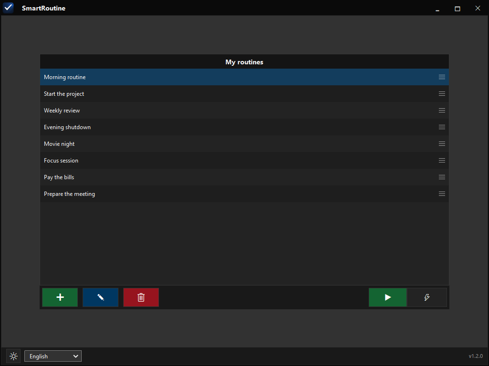
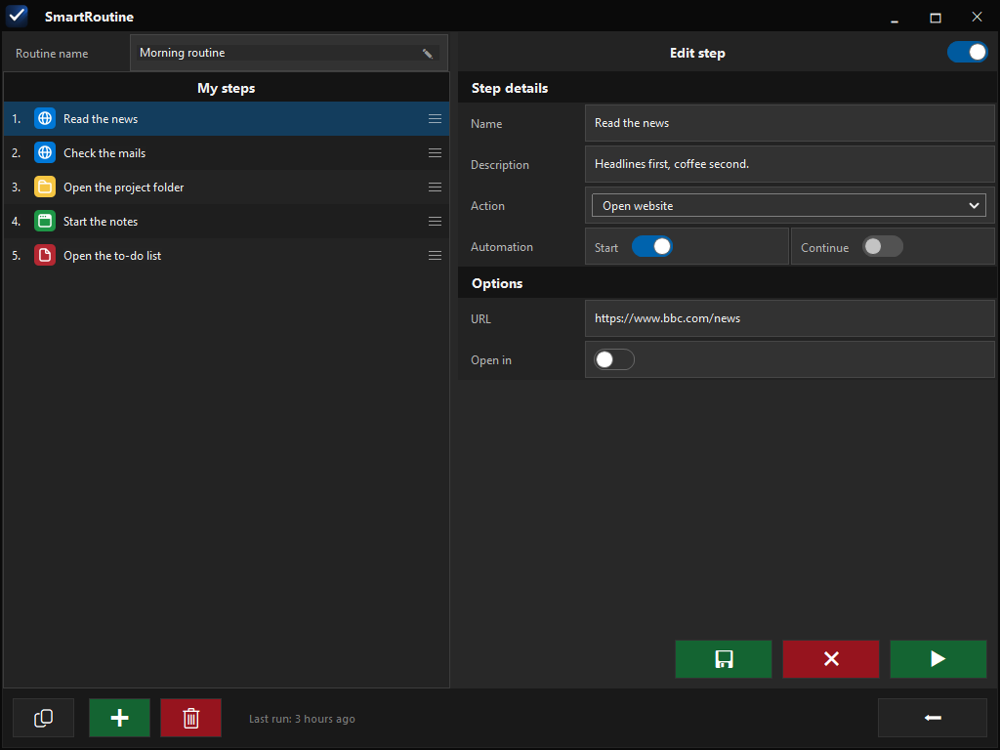

# SmartRoutine

SmartRoutine is a small Windows desktop app for automating recurring workflows: a routine is defined once as a sequence of steps — open a website, open a folder, start a program, open a document — and can then be started with one click.

## Features

- Routines with any number of steps (website, folder, program, document), sortable by drag and drop
- Guided or automatic run
- Automatic updates through GitHub
- English and German user interface; it starts in the language of Windows, and the language and the theme can be changed in the bar at the bottom of the main window

## Download

Get the latest version from the [Releases page](https://github.com/Erik513/SmartRoutine/releases): download `SmartRoutine.exe` and start it, no installer needed. Updates are detected automatically afterwards.

## Usage

Create a routine with **+**, add steps with **+ Add step**. Then go through it manually with **▶** or run it automatically with **⚡**.
